<p align="center"></p>

# Beffroi RM

Application web d'**appréciation et de traitement des risques numériques** selon la méthode
**EBIOS Risk Manager** de l'ANSSI (guide v1.5, septembre 2024, et fiches méthodes). Elle permet de
conduire de bout en bout une analyse de risques sur un périmètre défini, en équipe, avec des
visuels natifs à chaque atelier et des calculs fidèles à la méthode.

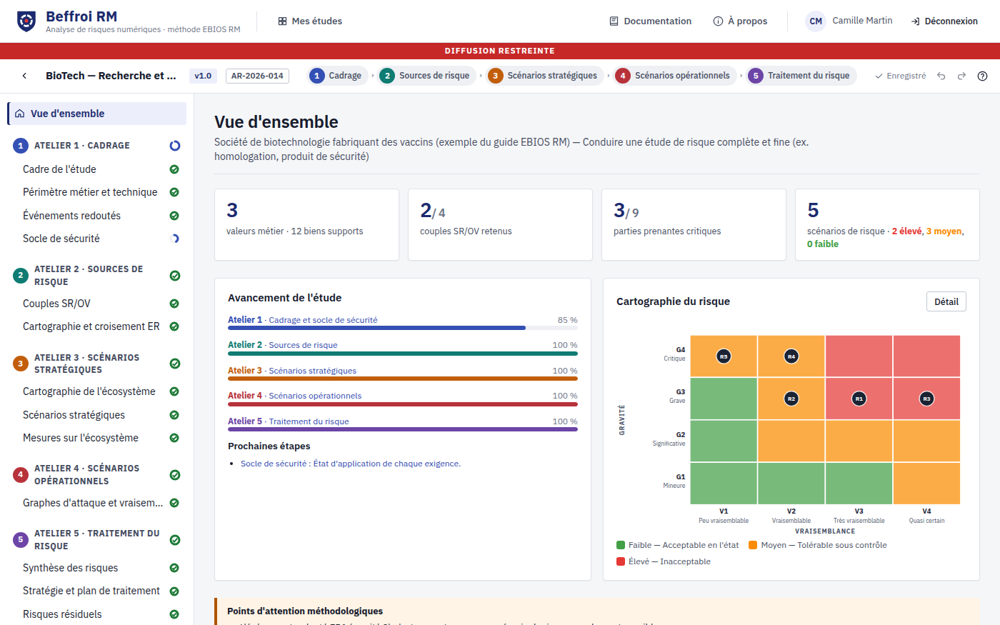

## Présentation en vidéo

[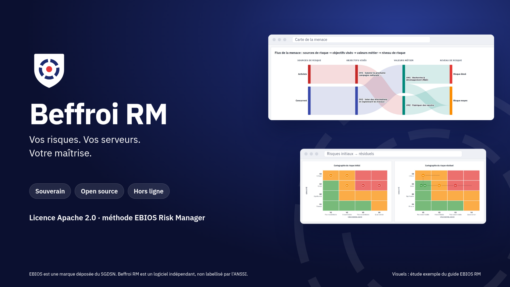](docs/promo/beffroi-presentation.mp4)

[Vidéo de présentation](docs/promo/beffroi-presentation.mp4) (16:9, 1080p, 57 s, sans son) : les
cinq ateliers, les cartographies, les graphes d'attaque, le rapport PDF, la souveraineté et
l'open source, illustrés par de vraies captures de l'application sur l'étude exemple de l'ANSSI.
Elle est régénérée par `npm run build && npm run promo` (ffmpeg et poppler-utils requis) ;
[affiche « souveraineté »](docs/promo/beffroi-souverainete.png) en image fixe.

## Fonctionnalités

| Atelier | Ce que l'application apporte |
|---|---|
| **1 · Cadrage et socle** | objectifs, participants et matrice RACI, cycles, planning ; missions, valeurs métier, biens supports (import CSV, carte du périmètre) ; événements redoutés et gravité ; socle de sécurité (guide d'hygiène ANSSI et NIS 2 intégrés, import CSV, radar de conformité) |
| **2 · Sources de risque** | sources de risque et objectifs visés, pertinence calculée (fiche 4), sélection, **radar SR/OV**, **croisement OV/ER** |
| **3 · Scénarios stratégiques** | dangerosité des parties prenantes `(D×P)/(M×C)`, **radars de dangerosité initial et résiduel**, parties prenantes critiques ; scénarios et chemins d'attaque par glisser-déposer, **diagramme en couloirs** ; mesures sur l'écosystème et niveaux cibles |
| **4 · Scénarios opérationnels** | **éditeur de graphes d'attaque** (Connaître / Rentrer / Trouver / Exploiter, ET/OU, catalogue d'actions élémentaires, biens supports), vraisemblance **expresse, standard ou avancée** calculée en direct, mode opératoire le plus vraisemblable surligné |
| **5 · Traitement du risque** | scénarios de risque générés, **cartographies du risque initial et résiduel** (glisser-déposer), couverture des ER, stratégie d'acceptabilité, **plan de traitement** (tableaux de bord, échéancier), fiches de risques résiduels, cadre de suivi |
| Synthèse | **carte de la menace** (flux sources → objectifs → valeurs métier → niveaux de risque) |

Et aussi : valeurs calculées **forçables** et signalées, **versions x.y** (cycles opérationnel et
stratégique) avec synthèse automatique des modifications, **mention de protection** sur chaque
écran et livrable, **exports PDF, Word, Excel et JSON**, reprise du **modèle Excel de l'ANSSI**, bases de connaissances modifiables et
fusionnables, aide méthodologique contextuelle, annuler/rétablir, sauvegarde automatique,
raccourcis clavier, exemple fil rouge du guide (société de biotechnologie) prêt à l'emploi.

| | |
|---|---|
| 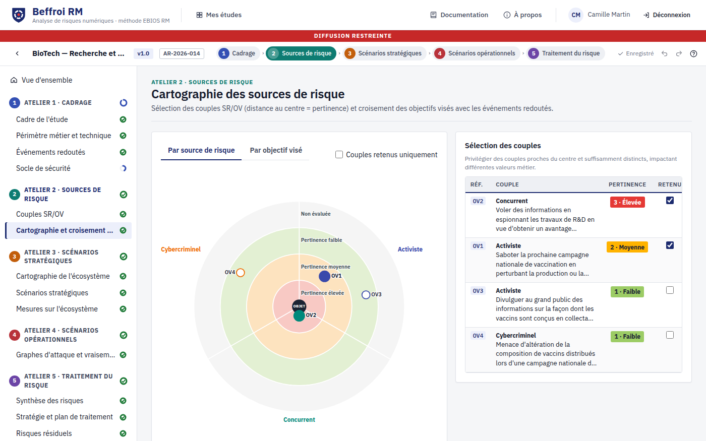 | 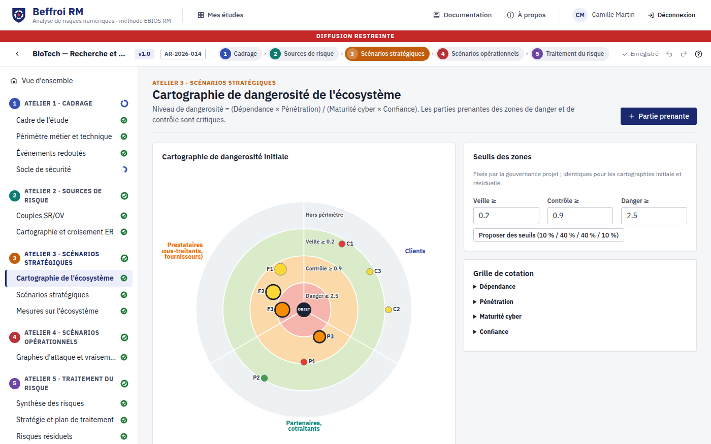 |
| 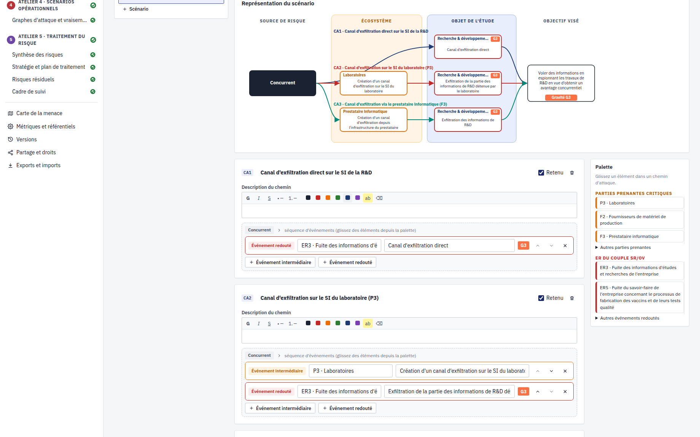 | 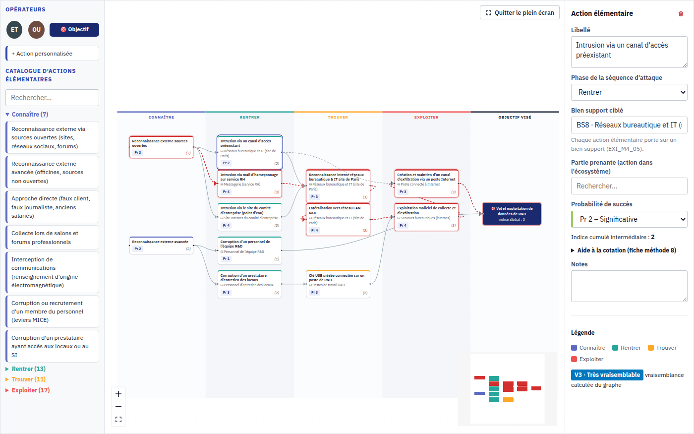 |
| 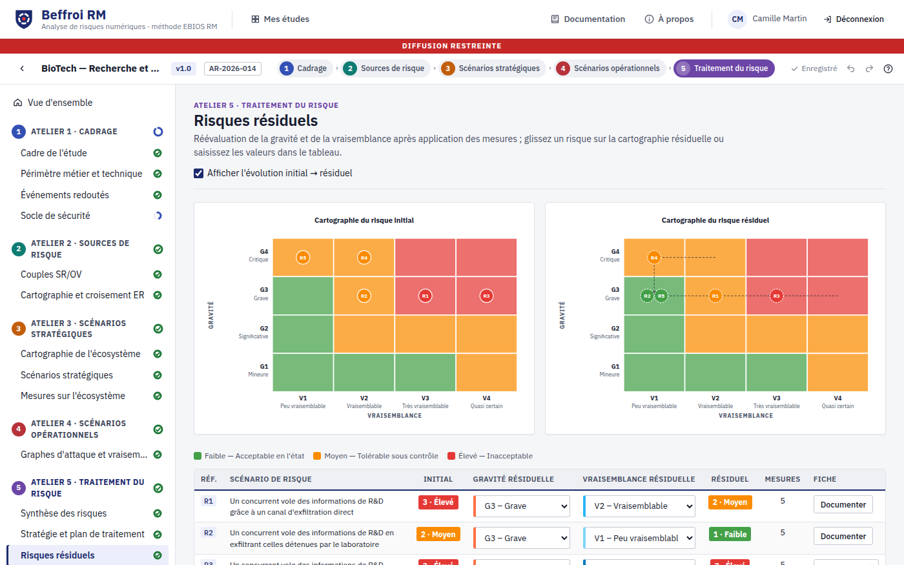 | 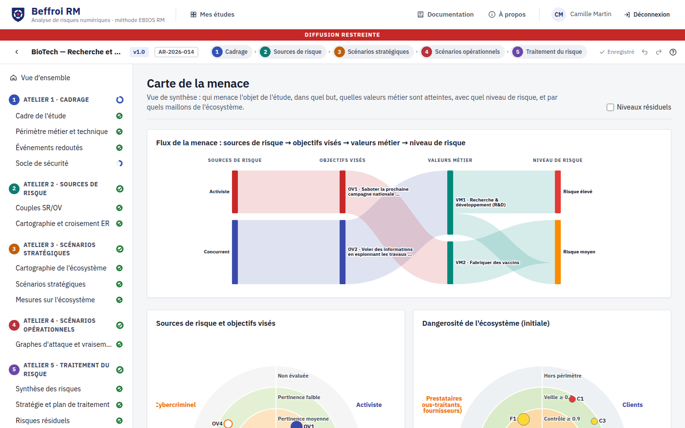 |
| 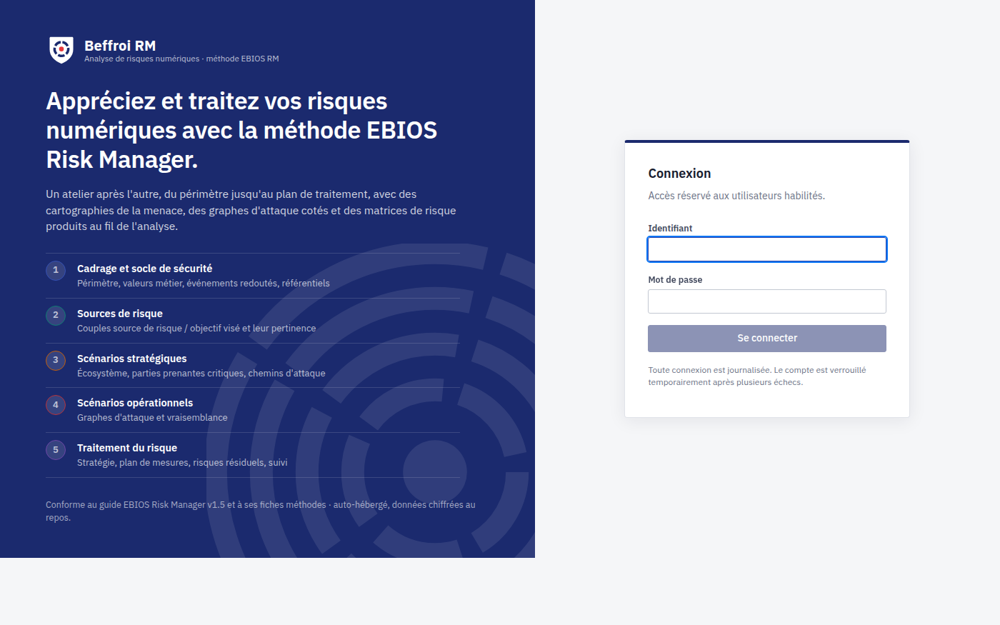 | 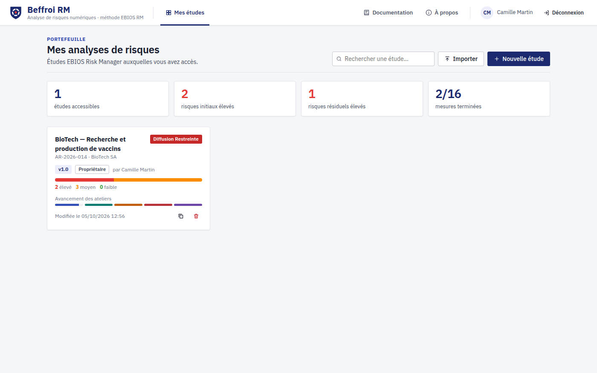 |

## Nom et identité visuelle

**Beffroi RM** (RM pour *Risk Manager*) : dans les villes du Nord et de Flandre, le beffroi était la tour de guet d'où l'on
surveillait l'horizon et sonnait l'alerte, et le symbole des libertés communales. Surveiller la
menace, alerter les décideurs, décider soi-même de son risque : c'est le rôle de l'outil, produit
français et auto-hébergé. Le nom de la méthode (EBIOS, marque déposée du SGDSN) n'est employé que
pour désigner la méthode suivie.

Le logo associe un **écusson** (la sécurité) à un **anneau de cinq segments** (les cinq ateliers
de la méthode) autour d'un **point rouge** (le risque, objet de l'analyse). Charte sobre et
institutionnelle : bleu marine `#1b2a6e`, gris neutres, rouge `#e5383b` réservé au risque, police
**IBM Plex Sans** (licence SIL OFL) embarquée dans l'application, sans appel à un service tiers.
Fichiers : [`docs/img/logo.png`](docs/img/logo.png), [`docs/img/logo-mark.svg`](docs/img/logo-mark.svg),
`web/public/favicon.svg`, `apple-touch-icon.png`, `icon-512.png`.

L'interface s'inspire des principes du Système de design de l'État (sobriété, contrastes, focus
visible) sans reprendre ses éléments réservés aux sites de l'État (bloc-marque, Marianne).

## Sécurité

Conçue « sécurisée par défaut », d'après le **cahier des charges du label EBIOS RM** (mode
client-serveur) et les guides de l'ANSSI — détail, menaces et risques résiduels dans le
[dossier de sécurité](docs/securite.md) :

- **Authentification** : second facteur TOTP **exigé par défaut** (anti-rejeu, codes de secours),
  ou authentification unique **OpenID Connect** (Keycloak, LemonLDAP::NG…) avec MFA vérifié ;
  mots de passe robustes (mots courants, identité et 5 derniers refusés) hachés en scrypt avec
  un **poivre** secret ; anti-énumération, verrouillage, limitation par adresse IP.
- **Sessions** : jeton de 256 bits haché en base, cookie `__Host-` `HttpOnly` `SameSite=Strict`,
  expiration (15 minutes pour l'administrateur), sessions visibles et révocables par l'utilisateur.
- **Données** : analyses **et métadonnées** chiffrées en AES-256-GCM, liées à leur enregistrement,
  avec des sous-clés dérivées par usage (HKDF) et une **rotation de clé** sans interruption ;
  secrets en fichiers, jamais dans l'environnement.
- **Base de données au moindre privilège** : rôle propriétaire réservé aux migrations, rôle
  applicatif sans droit sur le schéma ; **journal en ajout seul** imposé par PostgreSQL.
- **Journal d'audit scellé** (HMAC-SHA256 chaîné, rétrogradation détectée), copié en JSON vers
  un SIEM ; l'administrateur n'y voit jamais le nom des analyses.
- **Navigateur** : CSP stricte sans script ni feuille de style injectés, COOP/COEP/CORP, Fetch
  Metadata, contrôle d'origine, anti-CSRF, aucune ressource tierce.

> Beffroi RM n'est pas, à ce jour, une solution labellisée par l'ANSSI.

## Souveraineté : 100 % local

- **Aucune requête sortante** : ni télémétrie, ni CDN, ni police ou service tiers ; tout est servi
  par Beffroi RM (CSP `default-src 'self'`). Le test de bout en bout échoue à la moindre requête
  vers un autre hôte.
- **Installation hors ligne** : une archive de moins de 5 Mo, documentation illustrée comprise (serveur en un seul fichier, sans
  `node_modules`) ; prérequis : Node.js et PostgreSQL. `npm run test:offline` rejoue tout le parcours depuis
  l'archive dans un espace réseau **sans Internet**.
- **Données chez vous** : base PostgreSQL sur votre infrastructure, études chiffrées avec une clé qui ne quitte pas
  votre infrastructure, exports (PDF, Word, Excel, JSON) générés dans le navigateur.
- **Transparence** : composants open source à licences permissives, nomenclature CycloneDX
  (`sbom.cdx.json`) et licences tierces livrées avec l'archive ; aucun script d'installation tiers
  (`.npmrc`), construction possible depuis un miroir interne.

Détails et recommandations d'hébergement : [guide d'utilisation, § 5](docs/guide-utilisation.md#5-souveraineté-et-fonctionnement-hors-ligne).

## Démarrage rapide

**Pour une personne seule** : téléchargez l'exécutable **mode poste seul** (Windows `.exe` ou
Linux) sur la page [Releases](../../releases), lancez-le : Beffroi RM s'ouvre dans le navigateur, sans
installation, sans base de données ni compte. Les études restent sur le poste ; pas de partage
([détails](docs/poste-seul.md)).

**Pour une équipe**, Beffroi RM est un **serveur** : les analystes travaillent ensemble depuis leur navigateur.
Docker n'est pas obligatoire : six modes d'installation, tous au même niveau de sécurité
(procédures complètes : **[guide d'installation](docs/installation.md)**).

| Mode | En bref |
|------|---------|
| **Linux natif** (systemd) | `sudo ./deploy/linux/installer.sh` depuis l'archive : compte de service, secrets transmis par systemd, unités durcies, rôles PostgreSQL au moindre privilège |
| **Docker Compose** | `./scripts/generer-secrets.sh && docker compose up -d --build` : application + PostgreSQL |
| **Image seule** | l'image Beffroi RM à côté d'un PostgreSQL existant (instance managée, grappe interne) |
| **Kubernetes** | `kubectl apply -k deploy/kubernetes` : profil *restricted*, NetworkPolicy, Ingress |
| **Poste d'évaluation** | `./beffroi.sh` (Linux, macOS) ou `beffroi.cmd` (Windows) depuis l'archive |
| **Sources** | `npm ci && npm run build && npm start` |
| **Poste seul** (un utilisateur) | exécutable Windows/Linux de la page Releases, ou `npm run poste` : aucun prérequis |

Reverse proxy HTTPS prêts à l'emploi (réglages TLS ANSSI) : [`deploy/nginx`](deploy/nginx),
[`deploy/haproxy`](deploy/haproxy).

Développement (API avec rechargement + client Vite sur http://localhost:5173) :

```bash
DATABASE_URL=postgres://beffroi@/beffroi npm run dev
```

Configuration, authentification unique et sauvegarde : [guide d'utilisation, § 1](docs/guide-utilisation.md#1-installation).

## Tests

```bash
npm test             # moteur (valeurs du guide), API, OIDC, sécurité (MFA, chiffrement, rôles PostgreSQL, journal)
npm run audit:deps   # vulnérabilités connues des dépendances de production
npm run typecheck    # tsc (moteur, serveur) + svelte-check (interface)
npm run build && npm run test:e2e   # parcours complet dans Chromium (Playwright)
npm run docs:screenshots            # régénère les captures de docs/img
npm run package                     # archive d'installation hors ligne (release/)
npm run test:offline                # parcours complet depuis l'archive, sans réseau (Linux)
npm run poste && npm run test:poste # exécutable du mode poste seul et son parcours dans Chromium
```

Le moteur est validé contre les valeurs publiées par l'ANSSI : dangerosité des parties prenantes
(fiche 5), indices cumulés du graphe d'attaque (fiche 8), vraisemblances V3/V2/V4/V2/V1 et niveaux
des risques R1 à R5 de l'exemple du guide.

## Socle technique

| Couche | Composants |
|---|---|
| Interface | Svelte 5, TypeScript, Vite ; Svelte Flow (@xyflow/svelte) pour l'éditeur de graphe d'attaque ; visuels SVG maison |
| Serveur | Node.js ≥ 22, Express 5, openid-client (OpenID Connect) |
| Données | PostgreSQL ≥ 14 (pilote `pg`), études chiffrées AES-256-GCM |
| Tests | Vitest (moteur, API, OIDC), Playwright (bout en bout, hors ligne) |
| Déploiement | Linux natif (systemd), Docker Compose, image seule, Kubernetes ou poste d'évaluation, derrière Nginx / HAProxy |

Ce socle est celui des services numériques de l'ANSSI dont le code est public
([MonServiceSécurisé](https://github.com/betagouv/mon-service-securise) : Node.js, TypeScript,
Express, PostgreSQL, Svelte, Vite, Vitest, Playwright ; [MonAideCyber](https://github.com/betagouv/mon-aide-cyber)),
et ses briques d'infrastructure sont inscrites au **SILL** (Node.js, PostgreSQL, Svelte, Vite,
Keycloak, LemonLDAP::NG, Nginx, HAProxy, Docker). Détail et alternatives écartées :
[conception, § 8](docs/03-conception-produit.md#8-choix-structurants-et-alternatives-écartées).

## Architecture

```
shared/   modèle de données, schéma de validation, moteur de calcul, bases de connaissances,
          exemple ANSSI (TypeScript, partagé client/serveur)
server/   API Express 5, PostgreSQL, sessions et OpenID Connect, ACL, chiffrement, journal d'audit
web/      interface Svelte 5 + Vite : ateliers, visuels SVG, éditeur de graphes (Svelte Flow),
          exports PDF (pdfmake), Word (docx) et Excel (exceljs)
e2e/      test de bout en bout Playwright
scripts/  lancement en développement, captures d'écran, archive hors ligne
docs/     sources ANSSI, synthèse de la méthode, benchmark, conception produit, guide d'utilisation
```

## Documentation

**Dans l'application** : le menu **Documentation** (accessible avant même la connexion) réunit
15 tutoriels pas à pas illustrés de captures d'écran — première connexion et second facteur,
création d'une étude, chacun des cinq ateliers, carte de la menace, livrables, versions et
partage, administration — ainsi qu'un glossaire EBIOS RM. Depuis chaque page d'étude, l'aide
méthodologique (**?**) ouvre le tutoriel du bon atelier. Les captures sont régénérées depuis
l'étude exemple de l'ANSSI par `npm run docs:screenshots`.

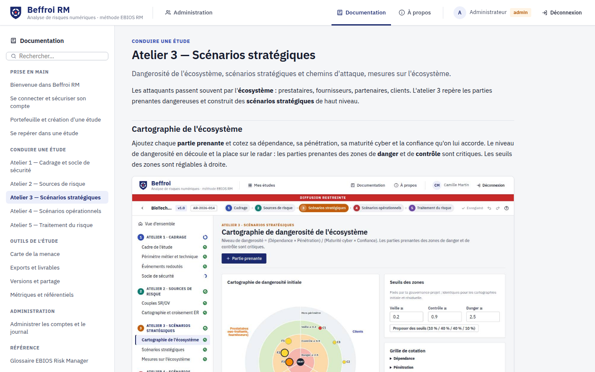

Dans le dépôt :

- [Synthèse de la méthode EBIOS RM](docs/01-methode-ebios-rm.md) — ateliers, formules, métriques, exigences du label
- [Benchmark des outils du marché](docs/02-benchmark-concurrents.md) — Egerie, Agile Risk Manager, Fence, CISO Assistant, tableur ANSSI
- [Conception produit](docs/03-conception-produit.md) — personas, périmètre, architecture, traçabilité des exigences du label
- [Guide d'installation](docs/installation.md) — six modes d'installation, reverse proxy HTTPS, vérification
- [Mode poste seul](docs/poste-seul.md) — exécutable Windows/Linux pour un utilisateur, sans serveur
- [Guide d'utilisation](docs/guide-utilisation.md) — configuration, administration, conduite d'une étude, recommandations
- [Dossier de sécurité](docs/securite.md) — menaces, mesures et tests, configuration de production, rotation de clé, risques résiduels
- [Sources ANSSI](docs/sources/) — guide, fiches méthodes, modèle Excel, cahier des charges du label (Licence Ouverte)

## Utilisation de l'IA dans ce projet

Beffroi RM a été développé avec l'assistance d'une IA générative, **Claude Code** (Anthropic). Une
grande partie du code, des tests et de la documentation a été rédigée par l'IA, à ma demande et
sous ma direction ; les commits concernés le mentionnent (`Co-Authored-By: Claude`). Je ne le
cache pas : c'est la façon dont le projet a été conduit.

L'IA n'a pas travaillé seule. Mes connaissances issues de mon bachelor en développement, une
méthode et des vérifications systématiques m'ont permis d'encadrer le projet :

- **un cadre de référence** : le guide EBIOS Risk Manager v1.5 de l'ANSSI, ses fiches méthodes
  et le cahier des charges du label ([docs/sources](docs/sources/)), avec une traçabilité des
  exigences ([conception, § 9](docs/03-conception-produit.md)) ;
- **des choix d'architecture décidés et justifiés** : fonctionnement 100 % local, socle aligné sur
  le SILL et sur les services numériques de l'ANSSI, mode serveur d'équipe, sécurité par conception
  ([conception, § 8](docs/03-conception-produit.md)) ;
- **un travail par étapes** : objectifs fixés à chaque étape, relecture des résultats, passes de
  revue par rapport aux objectifs initiaux avant chaque fusion sur la branche principale, et
  corrections demandées quand le résultat n'était pas conforme ;
- **des vérifications automatisées** : tests unitaires et d'API (Vitest), parcours complet dans
  un vrai navigateur (Playwright), contrôle de l'absence de toute requête sortante, test de
  l'archive d'installation sans aucun accès réseau, audit des dépendances et nomenclature
  logicielle (CycloneDX) ;
- **des déploiements réellement éprouvés** : Docker Compose, installation native systemd,
  image seule avec un PostgreSQL existant, derrière Nginx et HAProxy en HTTPS.

Limites assumées : ces vérifications ne remplacent pas un regard indépendant. Beffroi RM n'a pas
fait l'objet d'un audit de sécurité externe ni d'une labellisation par l'ANSSI ; les risques
résiduels sont décrits dans le [dossier de sécurité](docs/securite.md). Toute utilisation en
production suppose une recette et une homologation par l'organisation qui le déploie.

## Licence

Apache-2.0. Les documents de l'ANSSI reproduits dans `docs/sources/` sont diffusés sous Licence
Ouverte / Open Licence (Etalab). EBIOS est une marque déposée du SGDSN.
