# Guide d'utilisation — Beffroi RM

Ce guide couvre l'installation, l'administration, la conduite d'une étude EBIOS Risk Manager et
les recommandations d'emploi (cahier des charges du label ANSSI, § 3.3).

> **Documentation intégrée** : les mêmes tutoriels, illustrés pas à pas, sont consultables dans
> l'application (menu **Documentation**, accessible avant même la connexion), et chaque page
> d'étude y renvoie par l'aide méthodologique (**?** › **Tutoriel illustré**). Les captures sont
> régénérées par `npm run docs:screenshots`.

## 1. Installation

Beffroi RM est une application **serveur d'équipe** : un serveur Node.js, une base PostgreSQL, et
les analystes se connectent depuis leur navigateur. La procédure détaillée de chaque mode est dans
le **[guide d'installation](installation.md)**.

### 1.1 Prérequis

- Node.js **22.13 ou plus récent** (sauf déploiement par conteneurs : il est dans l'image).
- PostgreSQL **14 ou plus récent** (paquet de la distribution ou service interne).
- Un navigateur récent (Chrome, Edge, Firefox, Safari).

Ces composants sont inscrits au SILL (socle interministériel de logiciels libres) ; voir
[conception, § 8.1](03-conception-produit.md#81-socle-technique--pourquoi-ces-composants).

### 1.2 Modes d'installation

Docker n'est pas nécessaire. Tous les modes serveur appliquent les mêmes mesures : trois rôles
PostgreSQL (super-utilisateur, propriétaire du schéma réservé aux migrations, rôle applicatif sans
droit sur le schéma), secrets en fichiers, processus cloisonné, TLS terminé par un reverse proxy.

| Mode | Commande principale | Détail |
|------|---------------------|--------|
| Linux natif (systemd) | `sudo ./deploy/linux/installer.sh` | [installation, § 1](installation.md#1-linux-natif-systemd) |
| Docker Compose (base incluse) | `docker compose up -d --build` | [installation, § 2](installation.md#2-docker-compose) |
| Image seule + PostgreSQL existant | `docker run … beffroi` | [installation, § 3](installation.md#3-image-seule-et-postgresql-existant) |
| Kubernetes | `kubectl apply -k deploy/kubernetes` | [installation, § 4](installation.md#4-kubernetes) |
| Poste d'évaluation (Linux, macOS, Windows) | `./beffroi.sh` ou `beffroi.cmd` | [installation, § 5](installation.md#5-poste-dévaluation-linux-macos-windows) |
| Depuis les sources | `npm ci && npm run build && npm start` | [installation, § 6](installation.md#6-depuis-les-sources) |

Reverse proxy HTTPS (Nginx, HAProxy, réglages TLS ANSSI) :
[installation, § 7](installation.md#7-reverse-proxy-https).

### 1.3 Installation hors ligne

L'archive `beffroi-<version>.tar.gz` contient l'application complète : le serveur compilé en
**un seul fichier** (aucun `node_modules`, aucun `npm install`), le client web, les lanceurs,
l'installateur Linux et les fichiers de déploiement (`deploy/`), le guide d'installation, la
nomenclature logicielle et les licences. Elle s'installe sur une machine **sans accès Internet**.

```bash
sha256sum -c beffroi-1.0.0.tar.gz.sha256        # intégrité de l'archive
tar -xzf beffroi-1.0.0.tar.gz && cd beffroi-1.0.0
sha256sum -c SHA256SUMS                          # intégrité de chaque fichier
sudo ./deploy/linux/installer.sh                 # serveur Linux ; poste d'évaluation : beffroi.sh / beffroi.cmd
```

L'archive se construit depuis les sources avec `npm run package` (dossier `release/`) ;
`npm run test:offline` (Linux) rejoue le parcours complet de l'application extraite dans un
espace réseau isolé, sans Internet.

### 1.4 Premier démarrage et mises à jour

Au premier démarrage, le compte **administrateur** est créé. Son mot de passe initial est lu dans
`ADMIN_INITIAL_PASSWORD_FILE` s'il est fourni (il n'est alors jamais écrit dans les journaux),
sinon généré et affiché une seule fois dans la sortie du service. Il devra être changé à la
première connexion, puis le second facteur enrôlé.

Le schéma de la base est migré par le rôle propriétaire (`server.js --migrate`, ou au démarrage
si `DATABASE_MIGRATION_URL` est fourni). Plusieurs instances peuvent partager la même base
derrière un répartiteur de charge : les migrations et le journal d'audit sont protégés par des
verrous PostgreSQL.

### 1.5 Configuration

| Variable | Défaut | Rôle |
|---|---|---|
| `DATABASE_URL` | variables `PGHOST`, `PGUSER`, `PGDATABASE`… | Connexion PostgreSQL du rôle applicatif |
| `DATABASE_MIGRATION_URL` | — | Connexion du rôle propriétaire du schéma, pour les migrations seulement (`server.js --migrate`, ou au démarrage) |
| `DATABASE_PASSWORD_FILE` / `DATABASE_MIGRATION_PASSWORD_FILE` | — | Mot de passe lu dans un fichier et inséré dans l'URL correspondante |
| `DATABASE_SSL` / `DATABASE_SSL_CA_FILE` | `disable` | TLS vers PostgreSQL : `require` ou `verify-full` (certificat du serveur vérifié) |
| `DATABASE_POOL_SIZE` | `10` | Connexions simultanées par instance |
| `HOST` / `PORT` | `127.0.0.1` / `8080` | Adresse d'écoute |
| `DATA_DIR` | `./data` | Dossier de la clé maître générée |
| `BEFFROI_MASTER_KEY` | générée dans `DATA_DIR/master.key` | Clé maître (base64, 32 octets) dont dérivent les clés de chiffrement, de scellement du journal et de poivre |
| `BEFFROI_PREVIOUS_MASTER_KEYS` | — | Clés précédentes, séparées par des virgules, pendant une rotation ([dossier de sécurité, § 4](securite.md#4-rotation-de-la-clé-maître)) |
| `TLS_CERT` / `TLS_KEY` | — | Active HTTPS natif (TLS 1.2 minimum, suites AEAD) |
| `COOKIE_SECURE` | `true` si TLS | À activer derrière un reverse proxy HTTPS |
| `TRUST_PROXY` | `false` | Adresse IP cliente issue de `X-Forwarded-For` (journal) |
| `SESSION_IDLE_MINUTES` | `30` | Expiration de session après inactivité |
| `ADMIN_SESSION_IDLE_MINUTES` | `15` | Expiration de session de l'administrateur après inactivité |
| `SESSION_MAX_HOURS` | `12` | Durée maximale d'une session |
| `MAX_FAILED_LOGINS` / `LOCKOUT_MINUTES` | `5` / `15` | Verrouillage après échecs d'authentification |
| `ADMIN_INITIAL_PASSWORD` | généré | Mot de passe initial de l'administrateur |
| `LOCAL_LOGIN` | `true` | Connexion des analystes par mot de passe local (voir § 1.6) |
| `MFA_POLICY` | `required` | Second facteur des comptes locaux : `required` (tous), `admin` (administrateurs) ou `optional` |
| `AUDIT_STDOUT` | `false` | Copie de chaque entrée du journal d'audit sur la sortie standard (JSON), pour un SIEM |
| `RATE_LIMIT_PER_MINUTE` / `LOGIN_RATE_LIMIT_PER_MINUTE` | `600` / `20` | Requêtes d'API et tentatives de connexion par adresse IP et par minute |
| `LOG_LEVEL` | `info` | `error`, `warn` ou `info` |
| `STATIC_DIR` | `web/dist` | Fichiers du client web |

### 1.6 Authentification unique (OpenID Connect)

Beffroi RM s'appuie sur le fournisseur d'identité de l'organisation (Keycloak, LemonLDAP::NG ou tout
fournisseur OpenID Connect). Le flux utilisé est le code d'autorisation avec PKCE, `state` et
`nonce` ; les échanges sont conservés côté serveur.

| Variable | Rôle |
|---|---|
| `OIDC_ISSUER` | URL de l'émetteur (ex. `https://sso.exemple.fr/realms/beffroi`) |
| `OIDC_CLIENT_ID` / `OIDC_CLIENT_SECRET` (ou `OIDC_CLIENT_SECRET_FILE`) | Client confidentiel déclaré chez le fournisseur |
| `OIDC_REDIRECT_URI` | `https://<hôte>/api/auth/oidc/callback`, à enregistrer chez le fournisseur |
| `OIDC_SCOPES` | défaut `openid profile email` |
| `OIDC_LABEL` | libellé du bouton de connexion |
| `OIDC_ACR_VALUES` | niveau d'authentification exigé (ex. authentification multifacteur) : demandé au fournisseur **et vérifié** dans le jeton d'identité |
| `OIDC_AUTO_CREATE` | `true` : compte créé à la première connexion ; `false` : seuls les comptes préparés par l'administrateur peuvent se connecter |

Rattachement des comptes :

- une identité déjà connue (émetteur + identifiant `sub`) retrouve son compte ;
- sinon, un compte de type « authentification unique » préparé par l'administrateur est rattaché
  lorsque son identifiant correspond à `preferred_username` ;
- sinon, si `OIDC_AUTO_CREATE=true`, un compte analyste est créé et journalisé.

Avec `LOCAL_LOGIN=false`, les analystes ne peuvent se connecter que par le fournisseur
d'identité. Le compte **administrateur** reste toujours un compte local, pour garder la main en
cas d'indisponibilité du fournisseur.

### 1.7 Sauvegarde et restauration

Sauvegarder **séparément** :

1. la base PostgreSQL (`pg_dump -Fc beffroi`, ou la politique de sauvegarde de votre service
   PostgreSQL) ;
2. la clé maître (`DATA_DIR/master.key` ou la valeur de `BEFFROI_MASTER_KEY`).

Sans la clé maître, les études sauvegardées sont indéchiffrables : conservez-la hors de la
sauvegarde de la base, dans un coffre-fort de secrets. Chaque étude peut aussi être exportée
individuellement au format JSON (non chiffré).

### 1.8 Authentification multifacteur

Avec la politique par défaut (`MFA_POLICY=required`), chaque compte local active un second facteur
avant tout accès, juste après avoir remplacé son mot de passe initial :

1. confirmer son mot de passe, puis scanner le QR code avec une application d'authentification
   (FreeOTP, Aegis, coffre-fort de mots de passe…) ou saisir la clé affichée ;
2. saisir le code à 6 chiffres affiché par l'application ;
3. conserver les **10 codes de secours**, affichés une seule fois : chacun permet une connexion
   sans téléphone.

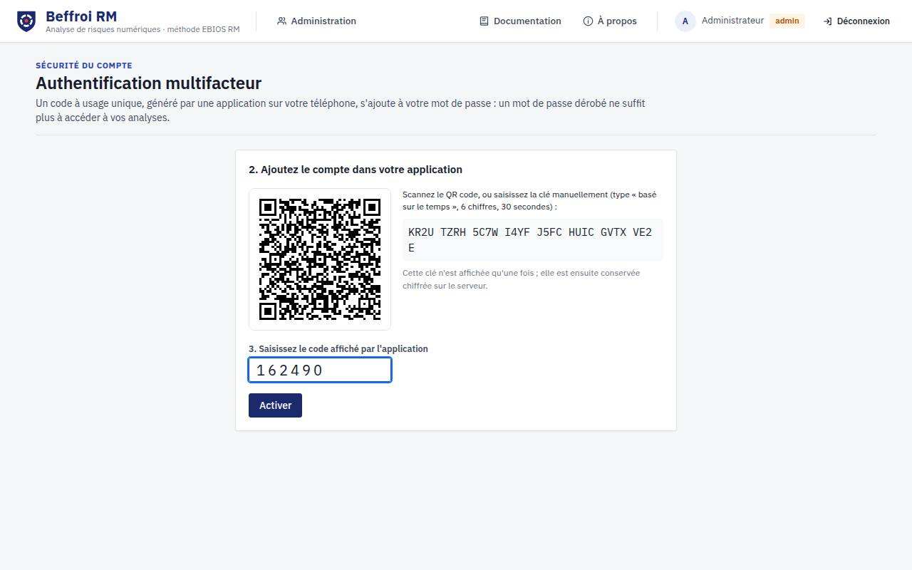

À chaque connexion, le code à usage unique est demandé après le mot de passe ; la date de la
connexion précédente et les éventuelles tentatives échouées depuis sont signalées. Depuis
**Mon compte**, l'utilisateur régénère ses codes de secours et consulte ou ferme ses sessions
ouvertes. En cas de téléphone perdu sans code de secours, l'administrateur réinitialise le second
facteur (le compte devra en enrôler un nouveau). Les comptes OpenID Connect relèvent du
fournisseur d'identité (`OIDC_ACR_VALUES`).

## 2. Administration

L'administrateur (menu **Administration**) :

- crée les comptes **nominatifs** (identifiant unique, fonction : RSSI, DSI, métier, direction…) ;
  un mot de passe temporaire est affiché une fois et doit être transmis par un canal sûr ;
- peut préparer un compte à **authentification unique** (sans mot de passe) qui sera rattaché à
  la première connexion par le fournisseur d'identité (§ 1.6) ;
- autorise ou non chaque analyste à créer des études ;
- réinitialise le second facteur d'un utilisateur (téléphone perdu) : ses sessions sont fermées ;
- déverrouille, désactive, réinitialise les comptes ;
- gère les **groupes** d'analystes (pour partager une étude avec une équipe) ;
- consulte, filtre, exporte (CSV) et **vérifie l'intégrité** du journal d'audit ; purge les
  entrées de plus d'un an (opération elle-même journalisée).

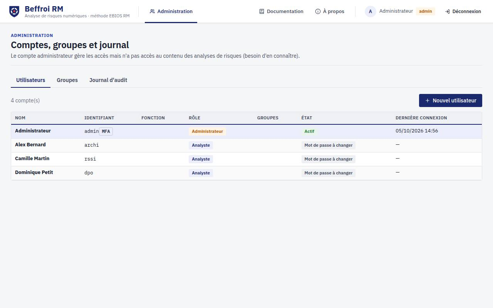

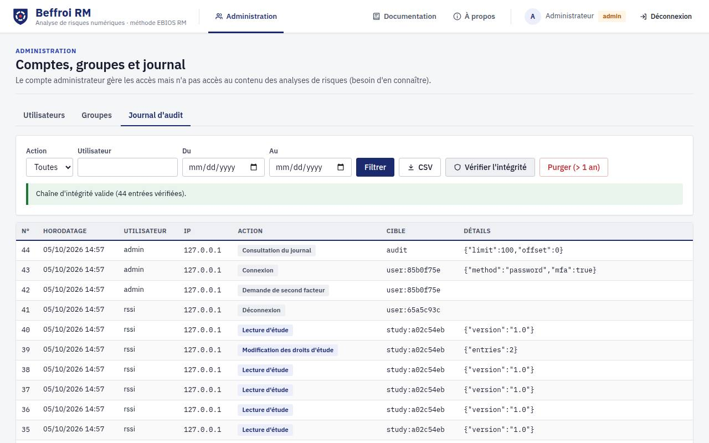

L'administrateur **n'a pas accès au contenu des analyses** (besoin d'en connaître) et ne peut pas en
recevoir les droits ; le journal qu'il consulte ne mentionne pas le nom des analyses. Sa session
expire après 15 minutes d'inactivité.

Politique de mot de passe : au moins 12 caractères combinant trois types (minuscules, majuscules,
chiffres, caractères spéciaux), sans mot courant même déguisé (« P@ssw0rd-2026 »), sans
l'identifiant ou le nom de l'utilisateur, sans suite ni répétition, et différent des 5 mots de
passe précédents. Une phrase de passe de plusieurs mots sans lien est recommandée.

## 3. Conduire une étude

### 3.1 Créer une étude

Depuis **Mes études** › **Nouvelle étude** : nom, référence, organisation, **mention de
protection** (obligatoire : elle apparaît sur chaque écran et chaque livrable), point de départ
(étude vide ou exemple du guide ANSSI) et taille des échelles (4 ou 5 niveaux).

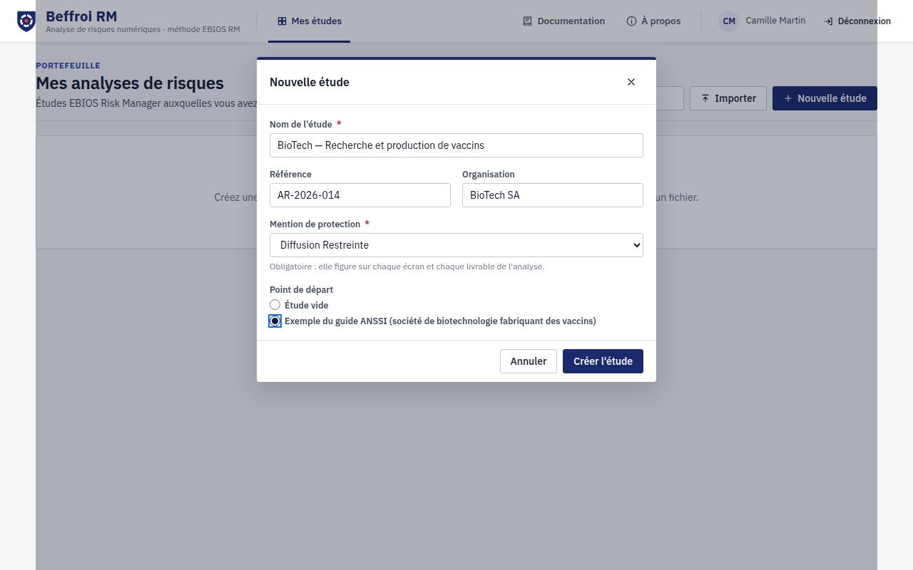

L'espace d'étude affiche en permanence la **carte de la méthode** (barre latérale et bandeau des
ateliers), l'avancement de chaque activité et une **aide méthodologique** contextuelle (icône ?).

Raccourcis : `Alt+1…5` ateliers, `Alt+0` vue d'ensemble, `Ctrl+Z` / `Ctrl+Y` annuler / rétablir,
`Ctrl+S` enregistrer. L'enregistrement est automatique ; en cas de modification concurrente par un
autre utilisateur, l'application propose de recharger ou d'écraser.

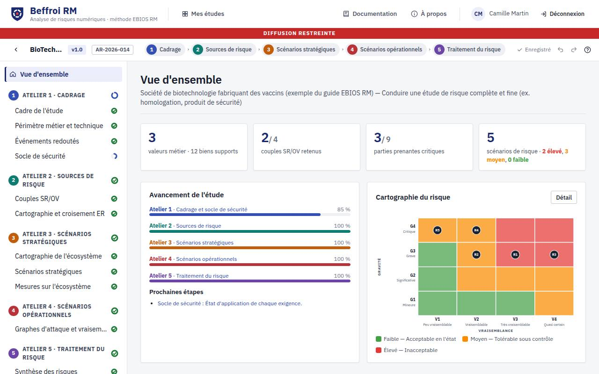

### 3.2 Atelier 1 — Cadrage et socle de sécurité

1. **Cadre** : objet, finalité (détermine les ateliers conduits), objectifs, participants et
   matrice RACI, responsable de l'acceptation des risques, cycles stratégique et opérationnel,
   hypothèses, contraintes, planning des séances.
2. **Périmètre** : missions, valeurs métier (nature, responsable, besoins D/I/C/T), biens supports
   (type selon la fiche méthode 1) ; import CSV (modèle téléchargeable) ; carte du périmètre.
3. **Événements redoutés** : par valeur métier, critères atteints, catégories d'impacts,
   gravité et justification ; un ER sans valeur métier représente un risque non intentionnel
   (vraisemblance expresse).
4. **Socle** : ajout de référentiels (guide d'hygiène ANSSI, NIS 2 art. 21, vide, import CSV),
   état de chaque exigence, écarts et justification, indicateur de couleur calculé ou forcé,
   radar de couverture, décision de poursuite.

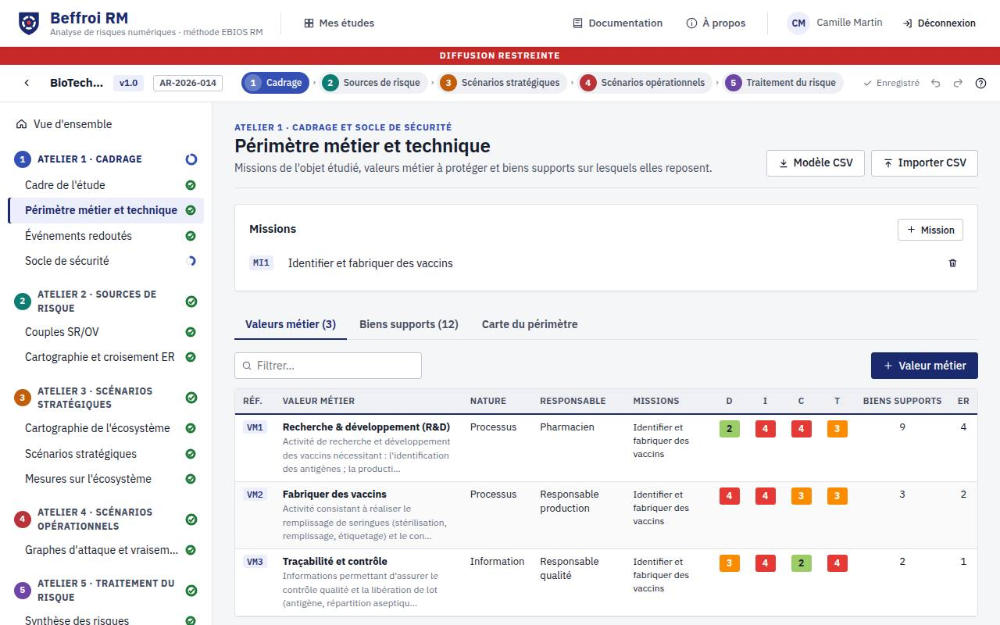

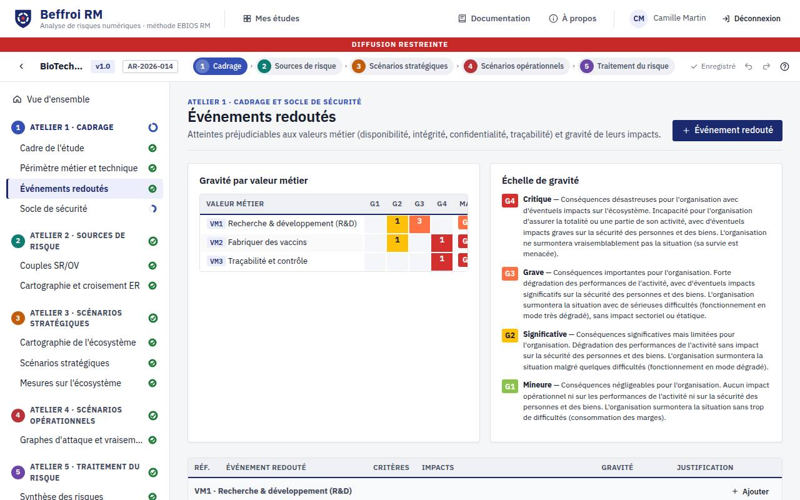

### 3.3 Atelier 2 — Sources de risque

Créer les sources de risque (catégories de la fiche méthode 4), puis leurs **objectifs visés**.
Coter motivation, ressources et activité : la **pertinence** est calculée (métrique de la fiche 4)
et peut être forcée. Retenir 3 à 6 couples (P1), justifier les exclusions. La cartographie radar et
la **matrice de croisement OV/ER** relient chaque objectif visé aux événements redoutés (les OV
héritent de leur gravité).

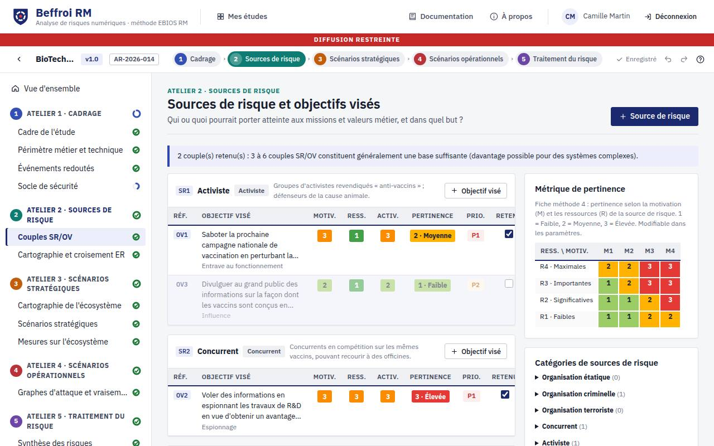

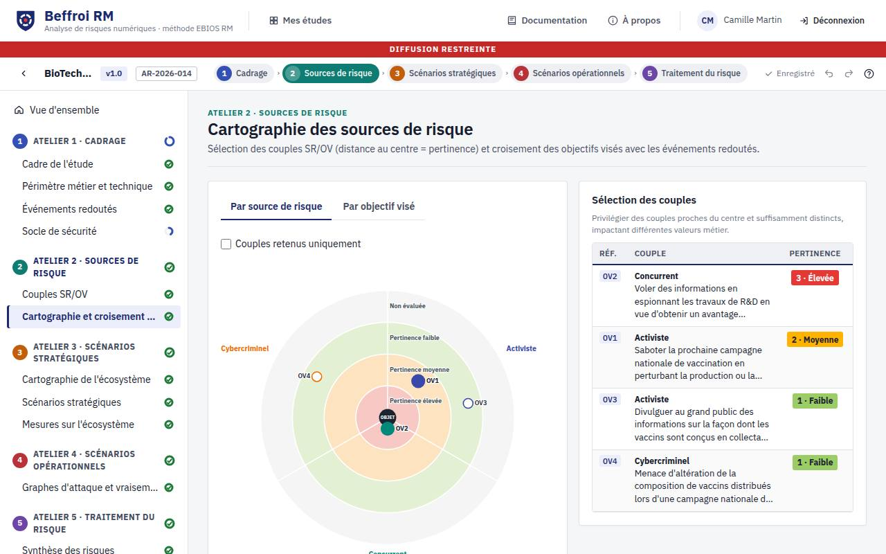

### 3.4 Atelier 3 — Scénarios stratégiques

1. **Écosystème** : parties prenantes, catégorie, rang, critères dépendance / pénétration /
   maturité / confiance. La dangerosité `(D×P)/(M×C)` et la zone sont calculées (seuils modifiables,
   proposition automatique 10/40/40/10 %) ; les parties prenantes des zones de danger et de contrôle
   sont proposées comme critiques.
2. **Scénarios stratégiques** : pour chaque couple retenu, des chemins d'attaque composés
   d'**événements intermédiaires** (partie prenante) et d'**événements redoutés** (valeur métier),
   ajoutés par glisser-déposer depuis la palette ; gravité calculée (forçable) ; diagramme en
   couloirs.
3. **Mesures sur l'écosystème** : mesures et **niveaux cibles** des critères par partie prenante ;
   la dangerosité résiduelle et la cartographie résiduelle (mêmes seuils) sont recalculées.

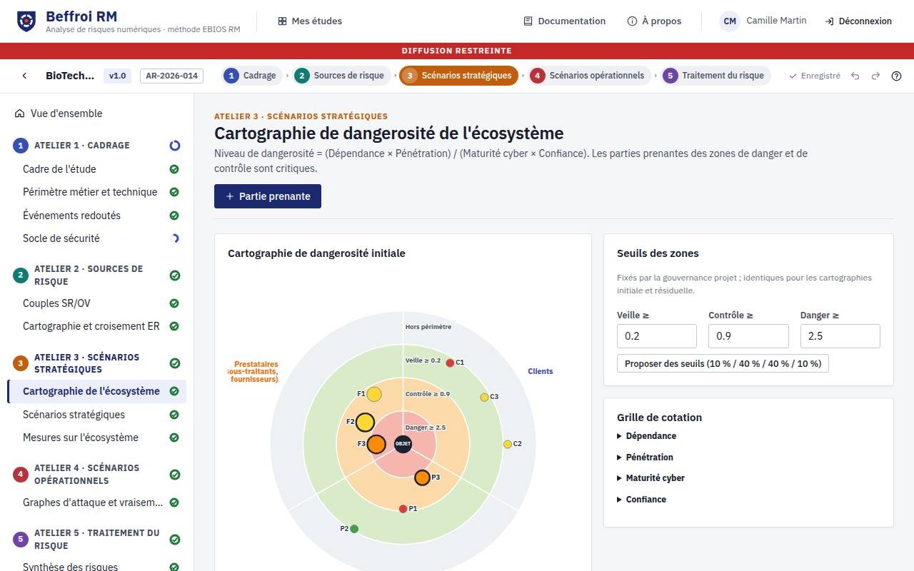

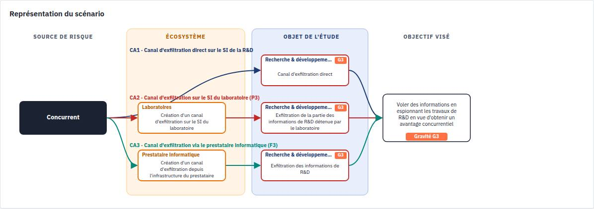

### 3.5 Atelier 4 — Scénarios opérationnels

Choisir la **méthode de vraisemblance** (expresse, standard, avancée), modifiable à tout moment.
Pour chaque chemin d'attaque, créer le scénario opérationnel puis construire le **graphe
d'attaque** : glisser les actions élémentaires du catalogue dans le couloir de leur phase
(Connaître, Rentrer, Trouver, Exploiter), relier les nœuds, ajouter des opérateurs ET / OU et le
nœud « objectif visé », rattacher chaque action à un bien support, coter la probabilité de succès
(et la difficulté technique en méthode avancée). Les indices cumulés et le **mode opératoire le
plus vraisemblable** sont recalculés en direct (fiche méthode 8) ; l'aide à la cotation est
affichée pour l'action sélectionnée. Le mode **plein écran** facilite la construction.

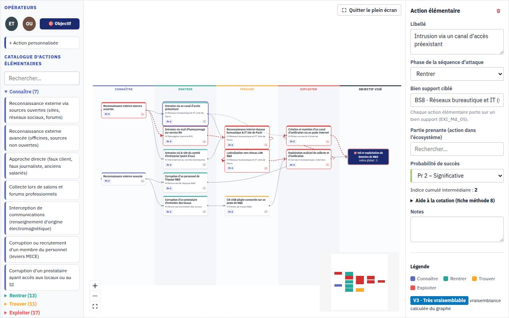

### 3.6 Atelier 5 — Traitement du risque

1. **Synthèse** : scénarios de risque générés automatiquement (un par chemin retenu, un par ER non
   intentionnel), cartographie du risque initial, filtres, vue par couple SR/OV, **matrice de
   couverture** des ER (angles morts).
2. **Stratégie et plan** : acceptabilité (depuis la cartographie ou le tableau), option de
   traitement, plan de traitement (catégorie, éléments concernés, responsable, freins, coût,
   charge, échéance, priorité, statut, avancement), tri et filtres, tableaux de bord et échéancier.
3. **Risques résiduels** : glisser les risques sur la cartographie résiduelle ou saisir gravité et
   vraisemblance résiduelles ; documenter chaque risque résiduel (modèle du guide p.78).
4. **Suivi** : comité de pilotage, indicateurs, déclencheurs de mise à jour.

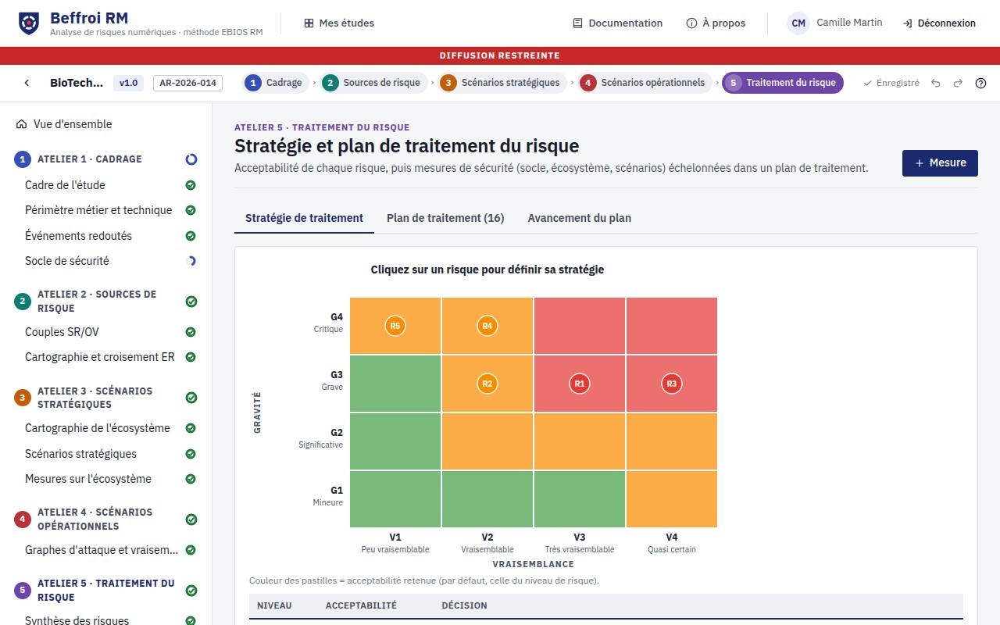

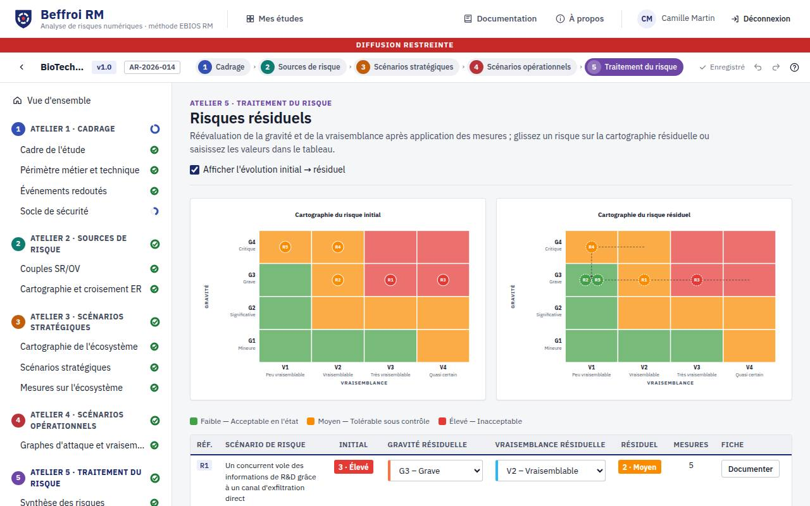

### 3.7 Versions

**Versions** › **Nouvelle version** : choisir un cycle **opérationnel** (x.y+1) ou **stratégique**
(x+1.0), décrire les modifications majeures et les ateliers concernés. La version courante est
figée et reste consultable ; la synthèse des modifications (ajouts, modifications, suppressions
par atelier et activité) est calculée automatiquement.

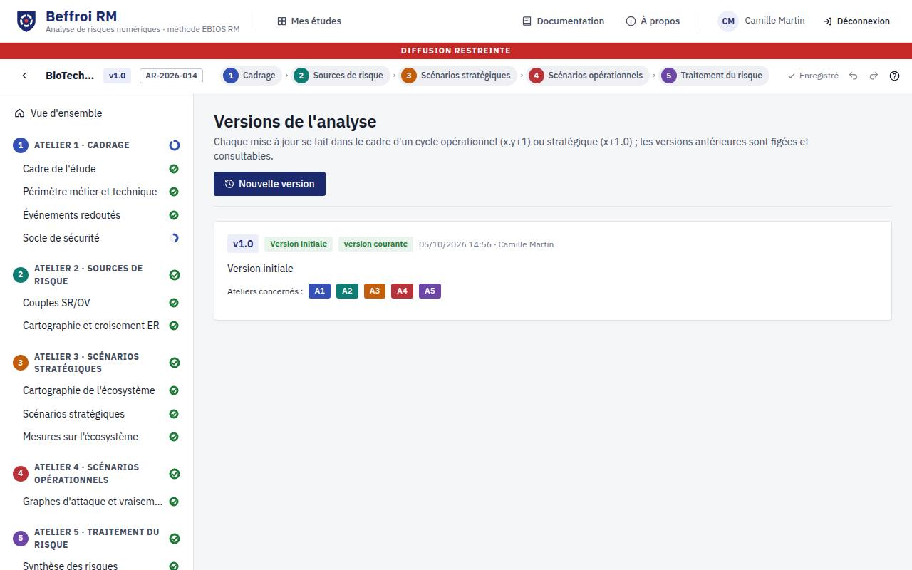

### 3.8 Partage

**Partage et droits** : le propriétaire accorde la lecture ou l'écriture à des utilisateurs ou des
groupes, et peut transférer la propriété. Les propriétés de l'étude (dont la mention de protection)
y sont modifiables.

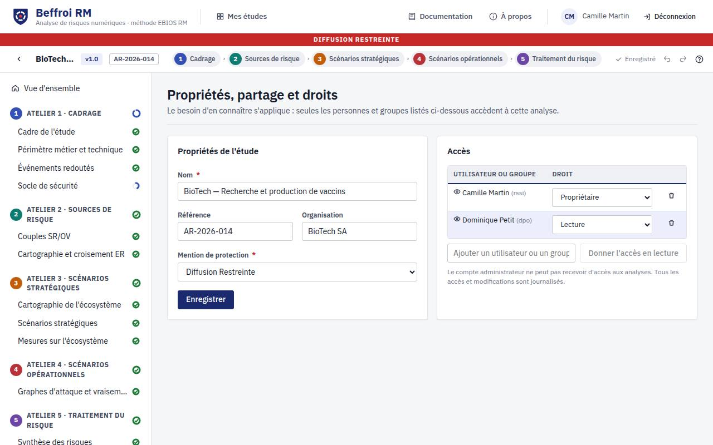

### 3.9 Exports et imports

- **Rapport PDF** : même contenu que le rapport Word, figé pour la diffusion et l'archivage
  (police et visuels embarqués, mention de protection en en-tête et pied de page de chaque page) ;
- **Rapport Word** (par ateliers) avec tableaux et visuels, modifiable ;
- **Classeur Excel** (un onglet par activité) ;
- **JSON** complet, ré-importable depuis le portefeuille ;
- **modèle Excel de l'ANSSI** (« EBIOS RM – Ateliers », .xlsx) : depuis le portefeuille,
  *Importer* accepte aussi ce classeur complété. Sont repris les missions, valeurs métier et
  biens supports, les événements redoutés et leur gravité, les écarts du socle, les couples
  SR/OV (motivation et ressources « + / ++ / +++ », pertinence, retenu), les parties prenantes et
  leurs critères, les scénarios stratégiques (chaque ligne numérotée devient un chemin
  d'attaque, la gravité est conservée comme valeur forcée), la vraisemblance globale des
  scénarios opérationnels (méthode expresse) et les scénarios de risque (index, intitulé,
  option de traitement). Un rapport liste ce qui a été repris et les points à reprendre à la
  main (séquences d'événements, graphes d'attaque, lignes non rattachées) ;
- imports CSV du périmètre et des exigences de référentiels, import/fusion JSON des bases de
  connaissances (paramètres).

Chaque export est journalisé. Les fichiers exportés ne sont **pas chiffrés**. Tous les exports sont
produits **dans le navigateur** de l'utilisateur : aucun fichier ne transite par un service tiers.

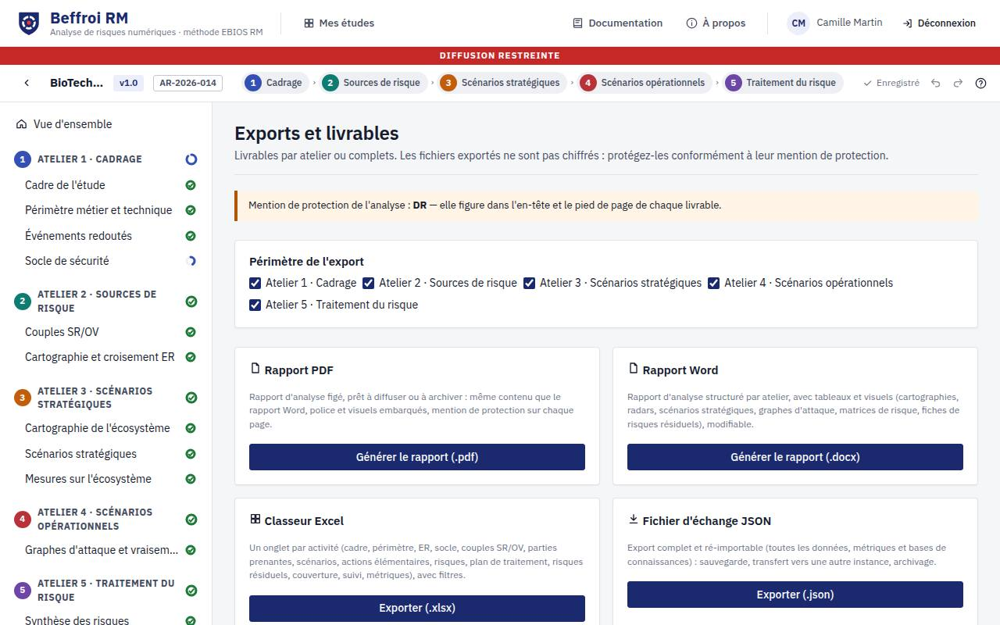

### 3.10 Paramètres et bases de connaissances

**Métriques et référentiels** : échelles (libellés, descriptions, couleurs), niveaux de risque et
acceptabilité, grilles de croisement (niveau de risque, pertinence, probabilité × difficulté),
pondération de la formule de dangerosité, correction des chaînes longues, catégories de sources de
risque / objectifs visés / parties prenantes / impacts / biens supports, séquence d'attaque et
catalogue d'actions élémentaires, aide à la cotation.

## 4. Recommandations d'emploi

- Une analyse de risques décrit les vulnérabilités de l'organisation : hébergez l'application sur
  un système **homologué** au niveau de sensibilité des analyses, derrière **HTTPS**.
- Renseignez la **mention de protection** adaptée ; l'application n'est pas conçue pour traiter
  des informations classifiées de défense.
- Restreignez les droits au **besoin d'en connaître** ; privilégiez les groupes.
- Conservez la **clé maître** hors de la sauvegarde de la base ; faites-la tourner en exportant
  puis réimportant les études si elle est compromise.
- Centralisez le journal (export CSV régulier ou collecte de la sortie standard) et vérifiez
  périodiquement son intégrité.
- Protégez les fichiers exportés selon leur mention de protection.

## 5. Souveraineté et fonctionnement hors ligne

Beffroi RM fonctionne **entièrement sur votre infrastructure**, sans dépendance à un service en ligne :

- **Aucune requête sortante.** Ni télémétrie, ni mise à jour automatique, ni police, script,
  carte ou service d'un tiers. La politique de sécurité du contenu (`default-src 'self'`) interdit
  au navigateur de charger quoi que ce soit hors du serveur Beffroi RM, et le moteur PDF a l'accès
  réseau désactivé. Le test de bout en bout échoue si une seule requête vise un autre hôte.
- **Fonctionnement vérifié sans réseau.** `npm run test:offline` exécute le parcours complet
  (connexion, cinq ateliers, sauvegarde, exports Word, PDF, Excel et JSON, import du modèle ANSSI)
  depuis l'archive d'installation, dans un espace de noms réseau sans accès Internet.
- **Données maîtrisées.** Base PostgreSQL sur votre infrastructure, études chiffrées en
  AES-256-GCM avec une clé qui reste chez vous (`master.key` ou `BEFFROI_MASTER_KEY`), exports
  générés dans le navigateur.
- **Composants ouverts et inventoriés.** Toutes les bibliothèques sont open source sous licences
  permissives (MIT, ISC, BSD, Apache-2.0…), listées dans `sbom.cdx.json` (CycloneDX) et
  `LICENCES-TIERS.txt`, livrés avec l'archive. Le serveur n'embarque aucun module natif.
- **Chaîne de construction.** `.npmrc` interdit les scripts d'installation des paquets tiers
  (certains envoient de la télémétrie à l'installation) ; la variable `registry` et l'argument
  Docker `NODE_IMAGE` permettent de construire depuis un miroir ou un registre interne.

**Hébergement.** Pour des analyses sensibles, hébergez Beffroi RM sur un système homologué, sur site
ou chez un hébergeur européen soumis exclusivement au droit de l'Union ; la qualification
**SecNumCloud** de l'ANSSI (liste des offres qualifiées sur cyber.gouv.fr) apporte la protection
contre les lois extraterritoriales. Beffroi RM ne requiert aucun service managé : un serveur Linux
avec Node.js et PostgreSQL suffit.

## 6. Conditions générales d'emploi

- L'évaluation de conformité réalisée par l'ANSSI au titre du label EBIOS Risk Manager se restreint
  aux aspects fonctionnels de la solution vis-à-vis de la méthode EBIOS Risk Manager.
- Le label EBIOS Risk Manager ne se substitue pas aux démarches de certification ou de
  qualification décrites par l'ANSSI.
- Le label EBIOS Risk Manager ne garantit en aucun cas la robustesse d'une application face à des
  actions malveillantes.
- Il est recommandé d'entreprendre une démarche d'homologation de sécurité de l'application
  (cyber.gouv.fr/lhomologation-de-securite).

Beffroi RM n'est pas, à ce jour, une solution labellisée par l'ANSSI.
